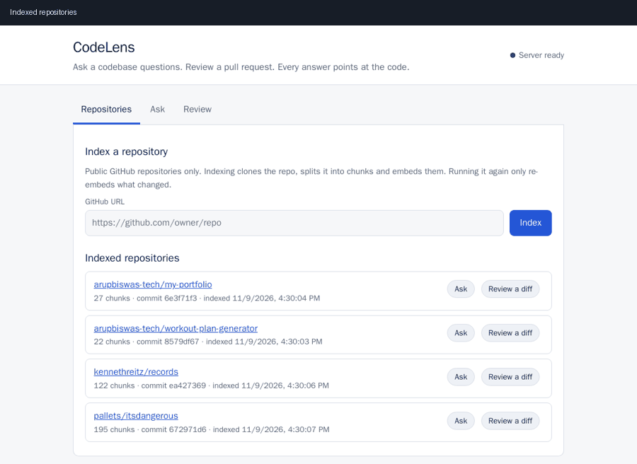
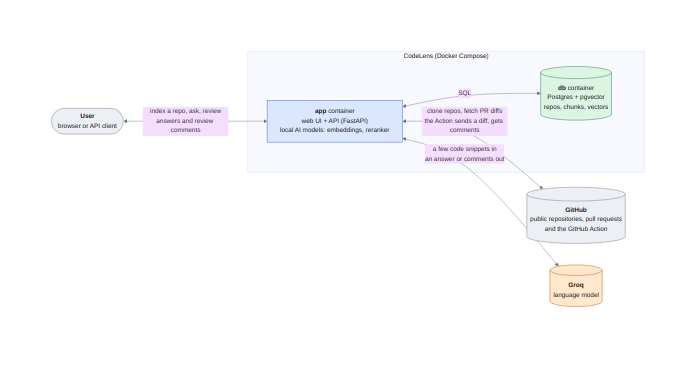
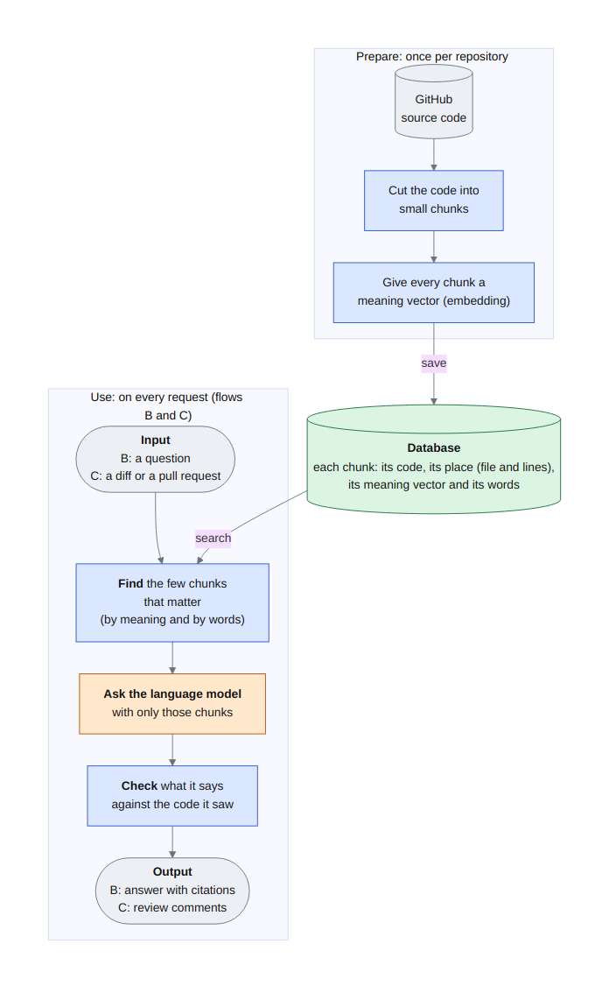

# CodeLens

Ask questions about a codebase and get answers with `file:line` citations. Review PR diffs with an agent that uses retrieved code as context. Built with FastAPI, Postgres + pgvector, and LangGraph. Everything runs in Docker.



> Status: milestone 7 in progress. Index a repo, ask questions with citations and review pull requests, from a web page or the API. The web UI, the GitHub Action and the local demo are done and verified locally; deployment is next. See [PROJECT.md](PROJECT.md) for the roadmap and [DECISIONS.md](DECISIONS.md) for design choices.

## Quick start

**New here? Follow [docs/RUNNING.md](docs/RUNNING.md):** a step-by-step guide to set up and run the app and the database, a tour of the web UI, and 15 verification scenarios with real examples and outputs.

The short version. It requires only Docker (with Compose v2) and a free [Groq API key](https://console.groq.com):

```bash
cp .env.example .env      # then set POSTGRES_PASSWORD and GROQ_API_KEY in .env
make up                   # builds the image, starts app + database
curl localhost:8000/ready
```

Then open **<http://localhost:8000>** for the web UI (index a repo, ask questions, review a diff or a pull request). The API documentation is at <http://localhost:8000/docs>.

The same things from the command line:

Index a public GitHub repo (the embedding model is baked into the image, so nothing is downloaded at runtime):

```bash
curl -X POST localhost:8000/repos -H 'content-type: application/json' \
     -d '{"url": "https://github.com/owner/repo"}'
# {"repo":"owner/repo","commit_sha":"...","chunks":122,"embedded":122,"reused":0,"deleted":0}
```

Call it again later: unchanged code is reused (`reused`), edited code is re-embedded (`embedded`), and code that no longer exists is removed (`deleted`).

Ask a question (needs `GROQ_API_KEY` in `.env`):

```bash
curl -X POST localhost:8000/ask -H 'content-type: application/json' \
     -d '{"repo": "owner/repo", "question": "Where is authentication handled?"}'
```

```json
{"answer": "Login is handled by `AuthService.login` [auth/service.py:L10-L42] ...",
 "citations": [{"path": "auth/service.py", "start_line": 10, "end_line": 42, "symbol": "AuthService.login"}],
 "ungrounded_citations": 0}
```

`citations` only lists references that match code the model was actually shown. `ungrounded_citations` counts references it made up (they are dropped). If the repo does not contain the answer, you get "I could not find this in the indexed code."

Review a pull request (the repo must be indexed first; needs `GROQ_API_KEY`):

```bash
curl -X POST localhost:8000/review -H 'content-type: application/json'      -d '{"pr_url": "https://github.com/owner/repo/pull/7"}'
# or send the diff yourself:  -d '{"repo": "owner/repo", "diff": "<unified diff text>"}'
```
```json
{"comments": [{"path": "records.py", "line": 255, "severity": "high",
               "body": "scalar() now returns row[1] instead of row[0], breaking its contract.",
               "evidence": [], "checked": true}],
 "files_reviewed": 1, "files_skipped": {}, "dropped": {}, "errors": [], "partial": false}
```

Each comment sits on a line the pull request really added (`line` is a line of the new file). `dropped` counts comments the self-check rejected, `files_skipped` says which files were not reviewable (docs, deletions, too large), and `partial` is true if the file cap or the time limit stopped the review early.

`/health` says the process is alive. `/ready` also checks the database and the pgvector extension, and returns 503 if either is missing.

## How it works



The idea behind everything: **prepare the code once, then use it on every request.** Indexing cuts a repository into chunks and gives each one a "meaning vector". Asking a question or reviewing a pull request first *finds the few chunks that matter*, then asks the language model with only those, then *checks* what it said against the code it saw.



**[docs/ARCHITECTURE.md](docs/ARCHITECTURE.md)** has the full set of data flow diagrams: indexing step by step, how an answer is found and verified, how a pull request review loop works, the GitHub Action, what is stored, and what runs where. Each diagram comes with a table explaining *why* every step exists.

## Evaluation

Measured on 29 hand-written questions over 4 public repos (26 answerable, 3 not). Every question is labelled with the code that answers it. Full method, limits and how to add questions: [eval/README.md](eval/README.md). Reasoning and trade-offs: [DECISIONS.md](DECISIONS.md) #23-28 (questions and answers) and #35-36 (reviewer).

**Retrieval: does the right code come back?** hit@k = the answer chunk is among the top k results.

| Pipeline | hit@1 | hit@3 | hit@6 | hit@10 | MRR |
|---|---|---|---|---|---|
| vector search only | 12/26 | 16/26 | 24/26 | 26/26 | 0.60 |
| keyword search only | 9/26 | 16/26 | 19/26 | 20/26 | 0.51 |
| hybrid (vector + keyword, RRF) | 13/26 | 19/26 | 22/26 | 23/26 | 0.63 |
| hybrid + reranker | 11/26 | 19/26 | 23/26 | 24/26 | 0.60 |

- **Hybrid earns its place:** best hit@3 and MRR, and keyword search is what finds exact names such as environment variables (MRR 0.75 vs 0.29 for vector, on 2 such questions).
- **The reranker is not proven:** it rescued some questions and ruined others, with no net gain at this sample size, for 0.4-1.8 s per question. It stays on for now; an answer-level A/B test (`make eval-no-rerank`) is still open.
- **Tuning changed nothing:** other chunk sizes, candidate counts and RRF constants were all within one question of the current settings (DECISIONS #25).

**Answers: are they right, and are they grounded?** One run with the real `/ask` pipeline.

| Measure | Result |
|---|---|
| Answers with at least one verified citation | 26/26 |
| Answers citing the labelled code | 22/26 |
| Made-up citations (dropped, never shown) | 0 |
| Faithfulness: claims supported by the shown code (mean, LLM judge) | 0.97 |
| Judged correct / partly correct / wrong | 25 / 1 / 0 |
| Wrongly refused to answer | 0/26 |
| Correctly refused an unanswerable question | 3/3 |

The 4 answers that did not cite the labelled chunk cited other relevant places (for example the README). The evaluation also found two real bugs, now fixed: citations with shortened paths were wrongly rejected (DECISIONS #26), and files with a byte-order mark lost their structure-aware chunks (#27). The citation rows were re-checked offline with the fixed matcher; `make eval` reproduces them end to end.

**Pull request reviewer: does it find real bugs without inventing problems?** 8 real `git diff`s made by mutating real files at pinned commits: 6 with one injected bug each, 2 harmless refactors. One complete run:

| Stage | Seeded bugs found (of 6) | Comments on the 2 clean diffs | Other comments on bug diffs |
|---|---|---|---|
| model's draft (quick, low reasoning effort) | 6 | 2 | 0 |
| after the rule check (line must be an added line, evidence must be real) | 6 | 1 | 0 |
| final, after the LLM self-check | **6** | **0** | **0** |

- **Every comment landed on exactly the seeded line.** The two false claims the draft made about a harmless rename were each caught by a different layer: one by the rule check (it was on a line the pull request did not add), one by the LLM check (it said a variable was unused when it is used).
- **An earlier version of the checker threw away a true SQL-injection finding** because of one wrong side remark. A third verdict, `partly`, now keeps the finding and shows the caveat (DECISIONS #31, #35). The same diff passes in this run.
- **Runs vary:** the subtle range-bound bug was missed in an earlier run and found in this one. Read it as a regression check, not a guarantee. 8 cases is a small sample.

**Read these numbers with care:** a small sample, questions written by the builder, and the judge is the same model that wrote the answers. They are good for catching regressions and obvious problems, not for ranking close settings.

```bash
make eval          # retrieval + answers (needs GROQ_API_KEY; about 100k LLM tokens)
make eval-tune     # plus the tuning experiments
make eval-review   # the pull request reviewer on seeded-bug diffs
```

## Common commands

| Command | What it does |
|---|---|
| `make up` / `make down` | Start / stop the stack |
| `make logs` | Follow app logs |
| `make test` | Ruff + pytest inside Docker, against a real pgvector database |
| `make reset` | Delete the DB volume and re-run `db/init.sql` |
| `make ingest URL=https://github.com/owner/repo` | Clone and chunk a repo, print a summary |
| `make eval` / `make eval-tune` | Measure retrieval and answer quality, see [Evaluation](#evaluation) |
| `make eval-review` | Measure the PR reviewer on seeded-bug diffs |
| `make demo` | Drive the web UI in a headless browser, check it, save screenshots (`ARGS=--no-llm`, `ARGS=--gif`) |

## Layout

```
src/codelens/
  config.py         settings from environment variables
  logging_setup.py  logging config
  errors.py         custom errors -> JSON responses
  db.py             connection pool + readiness check
  embeddings.py     local embedding model: batching, retry, startup dimension check
  store.py          save a repo: reuse embeddings, insert, delete stale, one transaction
  indexer.py        clone -> chunk -> embed -> store (what POST /repos calls)
  retrieval.py      vector + keyword search, merged with Reciprocal Rank Fusion
  reranker.py       cross-encoder that re-orders the merged candidates
  llm.py            OpenAI-compatible chat client (Groq) with safe error mapping
  answering.py      question -> retrieve -> rerank -> LLM -> verified citations (POST /ask)
  retry.py          retry-with-backoff helper shared by the local models
  review/           PR reviewer: diff.py (parse), graph.py (LangGraph loop), checks.py,
                    prompts.py, github.py (fetch a PR diff), models.py (POST /review)
  main.py           FastAPI app and endpoints
  static/           the web UI: index.html, app.js, style.css, examples.json
  ingestion/
    cloner.py       validate GitHub URL, shallow git clone
    walker.py       find indexable text files, skip binaries/large/ignored
    chunker.py      Python: functions/classes/methods via ast; others: line windows
    pipeline.py     clone -> walk -> chunk, always cleans up the temp clone
    models.py       Chunk (with file:line citation) and IngestResult
  evaluation/       dataset + metrics + judge + runner for `make eval`; reviews.py for `make eval-review`
scripts/            download_models.py (docker build), post_review.py (the GitHub Action)
tools/              demo.py (headless-browser UI check), render_diagrams.py (Mermaid to PNG), plot_embeddings.py
docs/               RUNNING.md (setup and scenarios), ARCHITECTURE.md (data flow diagrams), demo.gif, screens/, diagrams/
.github/workflows/  ci.yml (tests), codelens-review.yml (reviews pull requests)
eval/               questions.json + review_cases.json (test sets), make_review_cases.py, README, results/
db/init.sql         schema (repos, chunks, pgvector + full-text indexes)
tests/              pytest tests (SQL tests use a real database, see DECISIONS #15)
```

## First-time notes

- `uv.lock` is required: the Dockerfile uses `uv sync --locked`. After changing dependencies in `pyproject.toml`, run `uv lock` and commit the result.
- `db/init.sql` only runs on an empty volume. After editing it during development, run `make reset`. (If you used an earlier milestone, run it once now: the full-text column changed.)
