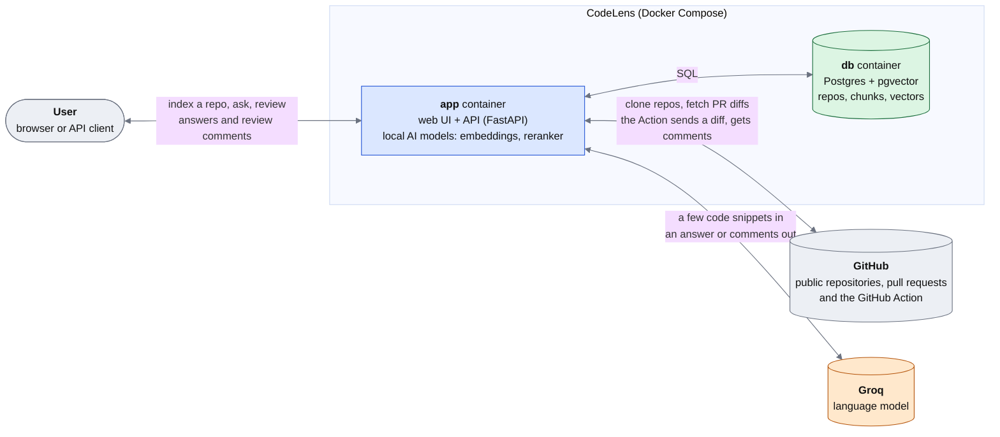
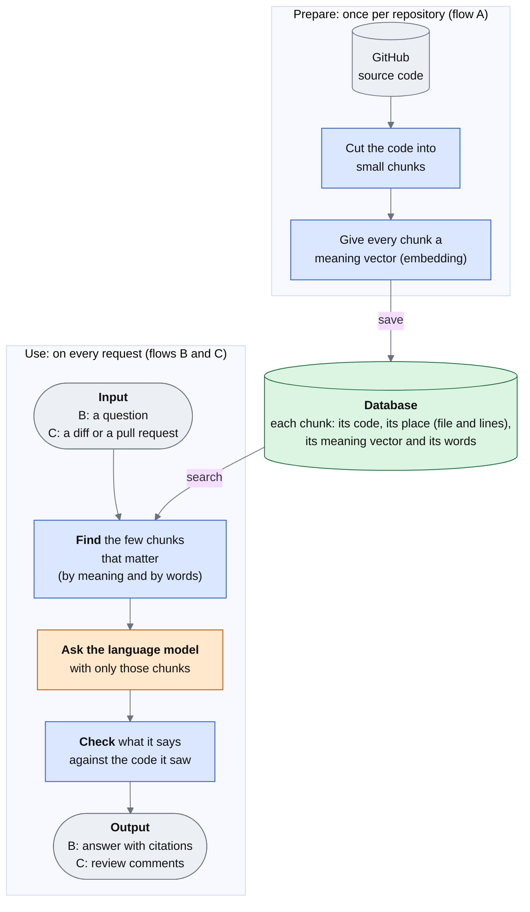
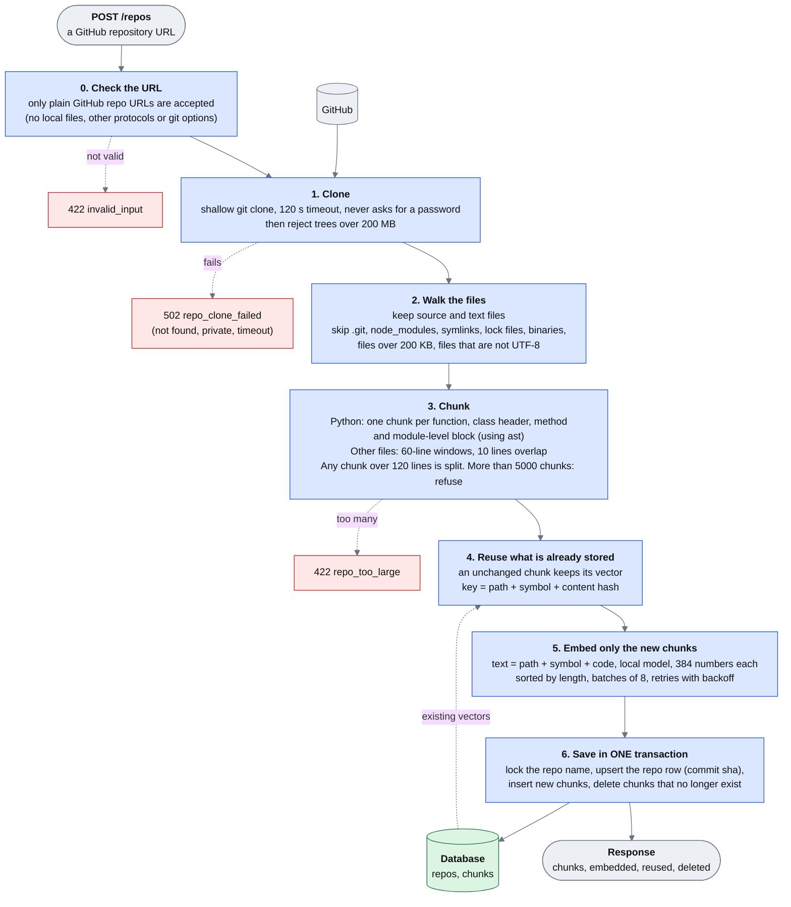
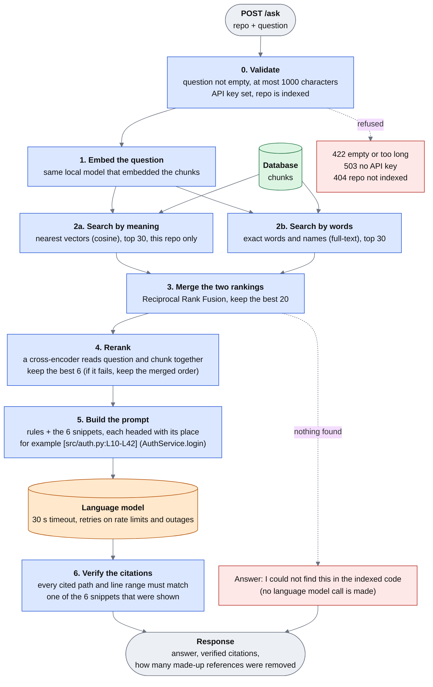
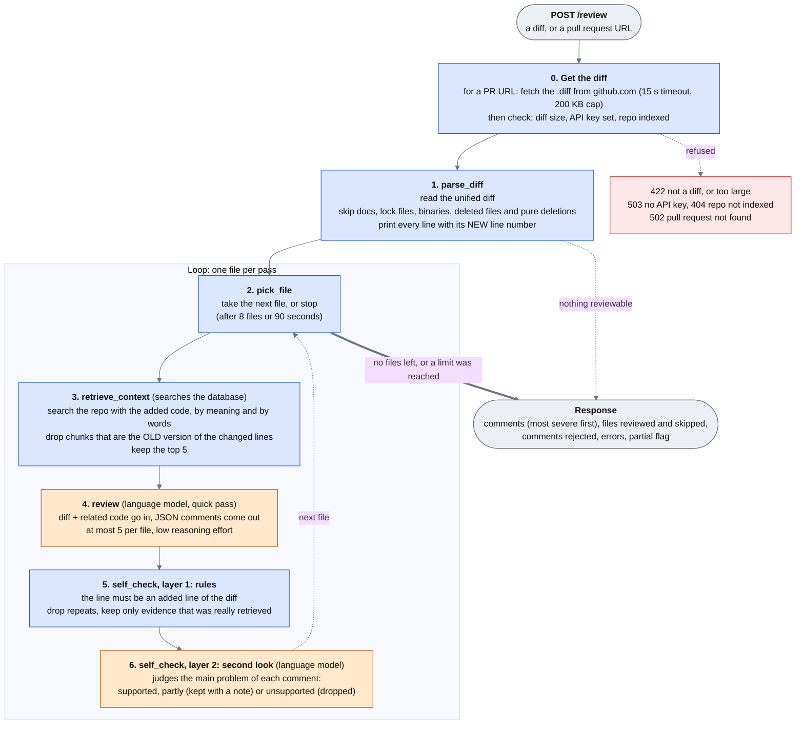
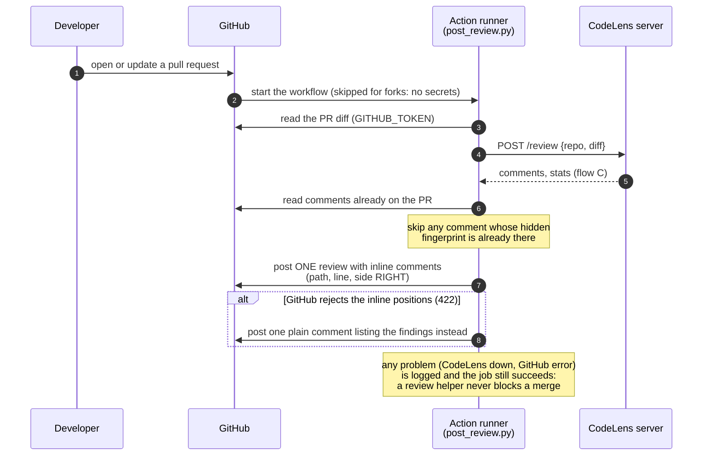
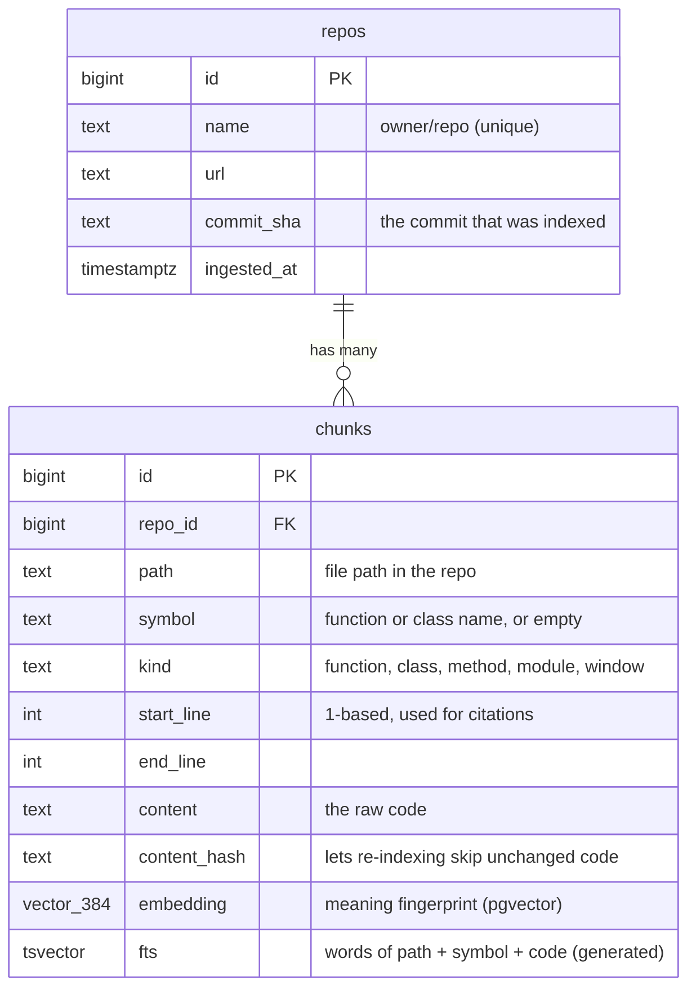
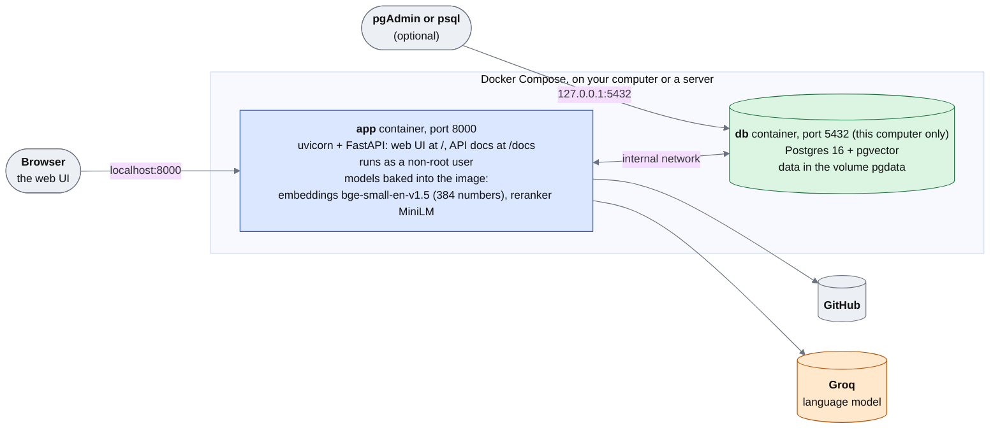

# CodeLens: how data flows through the system

This page explains the whole system with diagrams, from the big picture down to every step. Read it top to bottom: each diagram zooms into one box of the previous one.

| # | Diagram | Question it answers |
|---|---|---|
| 1 | [The big picture](#1-the-big-picture) | Who talks to whom? |
| 2 | [The three main flows](#2-the-three-main-flows) | What does the system do, and where is data kept? |
| 3 | [Flow A: indexing a repository](#3-flow-a-indexing-a-repository) | How does code become searchable? |
| 4 | [Flow B: asking a question](#4-flow-b-asking-a-question) | How is an answer found, written and checked? |
| 5 | [Flow C: reviewing a pull request](#5-flow-c-reviewing-a-pull-request) | How are review comments produced and verified? |
| 6 | [The GitHub Action](#6-the-github-action) | How do comments reach a pull request? |
| 7 | [What is stored](#7-what-is-stored) | What is in the database? |
| 8 | [What runs where](#8-what-runs-where) | Which containers, models and ports? |

GitHub draws the diagrams below by itself. PNG copies of each one are in [`docs/diagrams/`](diagrams/) for slides or places that do not render Mermaid (regenerate them with `make diagrams` after editing).

**Colour key used in every diagram:** blue = a step the system performs, green = stored data, orange = the language model (an outside service), grey = outside systems and people, red = a place where the request can be refused or stopped.

---

## 1. The big picture

**How to read it.** The user (or the GitHub Action) only ever talks to the `app` container. The app is the only part that talks to the database, to GitHub and to the language model. The embeddings and the reranker run **inside** the app container on the CPU, so they cost nothing and need no network. Only the final answer or review is written by the outside language model, and it only ever sees a handful of retrieved code snippets, never the whole repository.

---

## 2. The three main flows

**The idea in one paragraph.** Flow A prepares the code once: it cuts it into pieces and stores each piece together with a "meaning fingerprint" (a vector). Flows B and C then use that store as a search engine. When you ask a question, or when a pull request changes some code, CodeLens first *finds the few pieces that matter* and only then asks the language model, handing it exactly those pieces. This is called retrieval-augmented generation (RAG), and it is why answers can point at real lines of code.

---

## 3. Flow A: indexing a repository

`POST /repos` with `{"url": "https://github.com/owner/repo"}`. It takes seconds for a small repo and a minute or two for a large one.

**Why each step exists**

| Step | Why |
|---|---|
| URL check | The URL comes from a user, so only `https://github.com/owner/repo` is accepted. This blocks local files, other protocols and git options. |
| Shallow clone, size and chunk caps | Keep one request from running for hours or filling the disk. The temporary clone is always deleted. |
| Chunk by function, not by line count | A function is one idea. Retrieval works better on whole ideas, and the stored line numbers become exact citations. |
| Embed `path + symbol + code` | A method body alone does not say which file or class it belongs to. The header lets a question about "login" match `auth/service.py` even if the body never says it. The stored text (used for citations) stays the raw code. |
| Reuse by content hash | Re-indexing an unchanged repo embeds **0** chunks (about 1 s instead of about 5 s). Code that only moved to other lines keeps its embedding. |
| One transaction | Searches never see a half-updated repo, two indexing runs of the same repo cannot delete each other's rows, and a failure leaves the old data untouched. |

---

## 4. Flow B: asking a question

`POST /ask` with `{"repo": "owner/repo", "question": "Where is auth handled?"}`. Typically 2 to 5 seconds, most of it the language model.

**Why each step exists**

| Step | Why |
|---|---|
| Two searches (2a and 2b) | They fail in opposite ways. Meaning search finds "where is login handled" even if the word *login* is absent, but blurs exact names. Word search finds `DATABASE_URL` exactly but has no idea about synonyms. Measured: on questions about settings and names, keyword search beat vector search (0.75 vs 0.29 on the 2 such questions in the evaluation, a small sample); hybrid had the best top-3 overall. |
| Reciprocal Rank Fusion | The two searches score on different scales, so their scores cannot be added. Their *ranks* can: a chunk near the top of both lists wins. |
| Rerank | The first searches compare question and chunk separately, which is fast but approximate. A cross-encoder reads them together, which is precise but too slow for every chunk, so it only sees the 20 candidates. (Its benefit is not yet proven in the evaluation; see `DECISIONS.md` #19.) |
| Citation check | A language model can invent a believable `file.py:L10-L42`. Only references that match code it was actually shown are kept, and the response says how many were removed. |
| Refusal without a model call | If nothing relevant exists, the honest answer costs no tokens and cannot be a guess. |

---

## 5. Flow C: reviewing a pull request

`POST /review` with `{"repo": "owner/repo", "diff": "..."}` or `{"pr_url": "https://github.com/owner/repo/pull/7"}`. The repo must already be indexed: the reviewer uses its code as context. The review is a **loop** (a LangGraph): it handles one file per pass.

**Why each step exists**

| Step | Why |
|---|---|
| Numbered diff lines, then check the number | Models miscount lines in a raw diff. We print the numbers, the model copies one, and layer 1 verifies that line really is an addition. A wrong line number can no longer reach you. |
| Drop the old version of the changed code | The index holds the code *before* the pull request. Searching with the changed code would mostly return that same old code, calling it "related" and pushing out the callers and neighbours that actually help. |
| Quick pass, then a verifying pass | The first pass is cheap (about 100 to 250 tokens instead of thousands) but sometimes states things that are false. The second pass reads the code again and removes those. In the evaluation each layer removed a different false claim on a harmless change, and neither removed a real bug. |
| Three verdicts (`partly`) | A comment can be right about the problem but wrong about a side remark. Dropping it would throw away a true finding, so it is kept with the checker's caveat. |
| One file per pass, with a budget | Small prompts, one failing file cannot sink the rest, and the file and time limits live in one place. A stopped review is flagged `partial`. |

**If a language-model call fails:** that file is reported in `errors` and the review continues. Only if *every* file fails does the request fail (502). If only the second-look call fails, the comments are returned marked `checked: false` instead of being silently deleted.

---

## 6. The GitHub Action

How review comments reach a pull request. (This needs CodeLens deployed on a public address; GitHub's runners cannot reach `localhost`. You can try it locally with `--dry-run`, see `docs/RUNNING.md`, scenario 10.)

---

## 7. What is stored

| Index | Used for |
|---|---|
| HNSW on `embedding` (cosine) | The "search by meaning" step (2a) |
| GIN on `fts` | The "search by words" step (2b) |
| B-tree on `(repo_id, path)` | Looking up a file's chunks |
| Unique `(repo_id, path, start_line, content_hash)` | Re-indexing unchanged code is a no-op |

Nothing else is stored. Questions, answers and reviews are **not** saved: each request is answered and forgotten. Deleting a repo row deletes its chunks.

---

## 8. What runs where

| Fact | Detail |
|---|---|
| Everything runs in Docker | One `Dockerfile` (stages: base, test, runtime) and one `docker-compose.yml`. |
| Settings | Environment variables only (`.env`): database password, `GROQ_API_KEY`, model names, limits. No secrets in the image or the repo. |
| Models are baked into the image | The container starts in under a second and needs no internet for embeddings or reranking. |
| The only paid-quota dependency | The language model (Groq free tier: 200,000 tokens a day, 8,000 a minute). Everything else is local. |
| If the database is down | `/health` still answers, `/ready` and the data endpoints return a clear 503, and the app recovers by itself when the database returns. |

---

### Where each step lives in the code

| Step | File |
|---|---|
| Clone, URL check | `src/codelens/ingestion/cloner.py` |
| Walk and chunk | `ingestion/walker.py`, `ingestion/chunker.py` |
| Embeddings | `src/codelens/embeddings.py` |
| Save (transaction, reuse, delete stale) | `src/codelens/store.py`, `src/codelens/indexer.py` |
| Hybrid search and fusion | `src/codelens/retrieval.py` |
| Rerank | `src/codelens/reranker.py` |
| Ask: prompt, citations | `src/codelens/answering.py`, `src/codelens/llm.py` |
| Review: diff, graph, checks | `src/codelens/review/diff.py`, `graph.py`, `checks.py`, `prompts.py` |
| GitHub Action | `scripts/post_review.py`, `.github/workflows/codelens-review.yml` |
| Web UI | `src/codelens/static/` |
| Database schema | `db/init.sql` |
