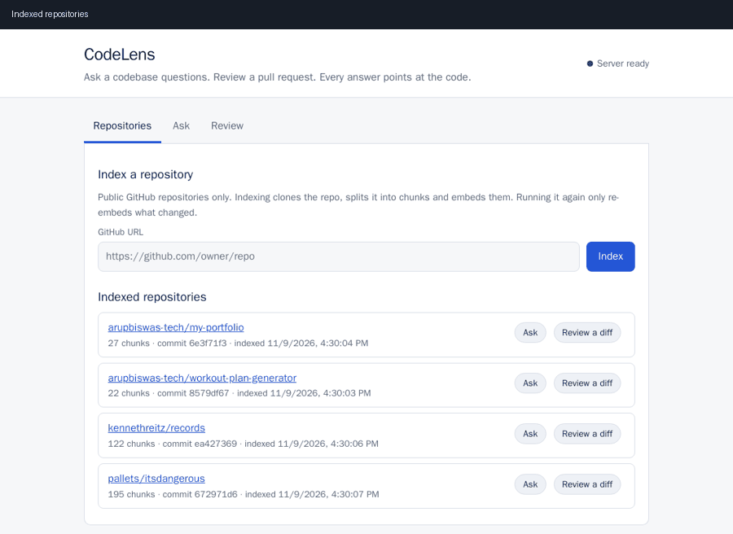
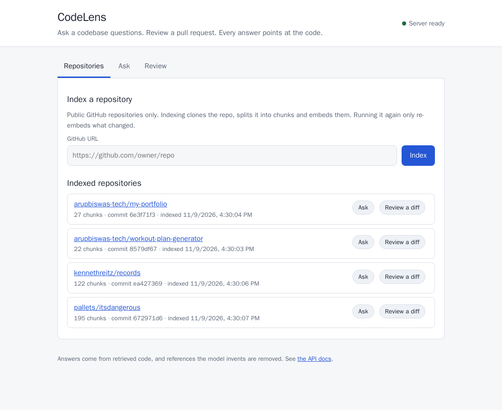
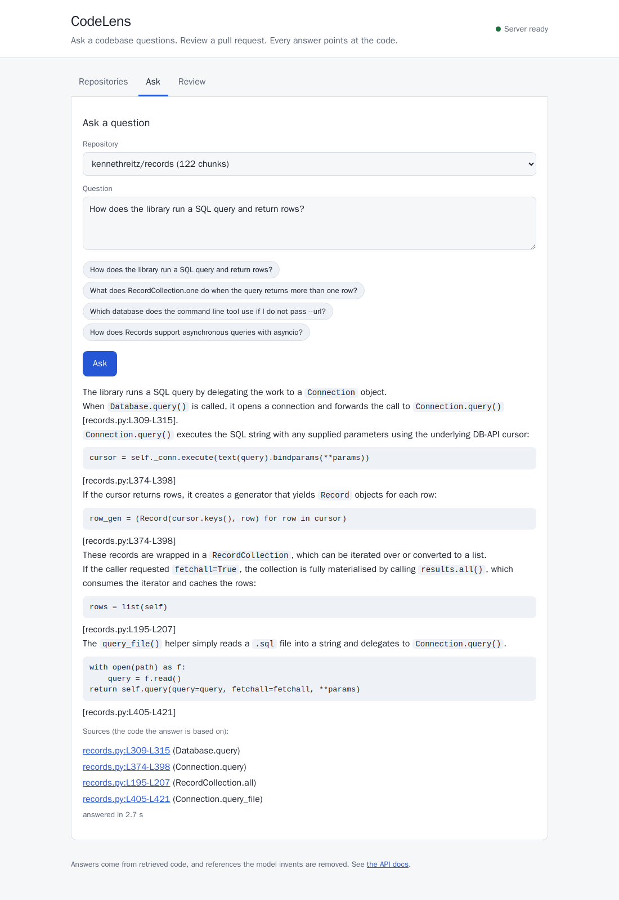
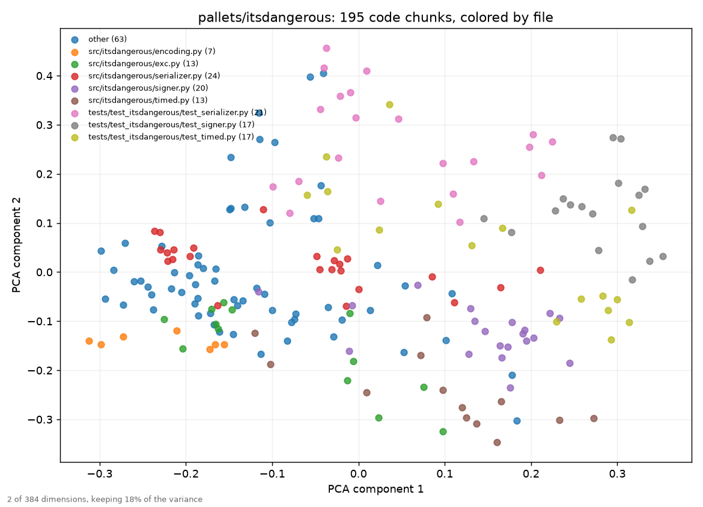
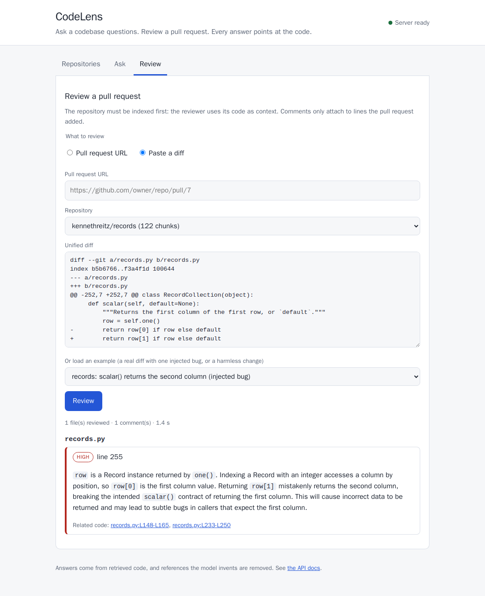

# Running CodeLens: setup, UI, database and verification scenarios

This guide takes you from nothing to a working app, then walks through scenarios that prove each part works. Every command and output below was run against the real stack; your answer wording will differ a little, because the language model is not deterministic.



> Want to understand how it works inside before running it? Read [ARCHITECTURE.md](ARCHITECTURE.md): data flow diagrams from the big picture down to every step.

**Contents**
1. [What you need](#1-what-you-need)
2. [Set it up (7 steps)](#2-set-it-up-7-steps)
3. [Tour of the UI](#3-tour-of-the-ui)
4. [The database](#4-the-database)
5. [Verification scenarios](#5-verification-scenarios) (15 scenarios with examples)
6. [The GitHub Action](#6-the-github-action)
7. [Stop, reset, clean up](#7-stop-reset-clean-up)
8. [Troubleshooting](#8-troubleshooting)

---

## 1. What you need

| Need | Why | Check |
|---|---|---|
| **Docker Desktop** (Windows, macOS) or Docker Engine + Compose v2 (Linux) | Everything runs in containers; nothing else is installed | `docker --version` and `docker compose version` |
| **A Groq API key** (free) | The language model that writes answers and reviews | Create one at <https://console.groq.com> |
| **Free ports 8000 and 5432** | The app and the database | Stop anything else using them |
| About **2.5 GB of disk** and **1 GB of free RAM** | Measured: the app image is 1.4 GB, the database image 0.6 GB; the running app uses about 0.9 GB (it holds two small AI models), the database about 40 MB. The optional browser demo (`make demo`) adds a 3.4 GB image. | `docker images` |

No Python, Node or Postgres installation is needed. `make` is optional: every `make` command below has a plain `docker compose` equivalent shown next to it.

> **Free-tier limit to know about:** Groq's free tier allows 200,000 tokens per day and 8,000 per minute for the model used here. One question costs roughly 3,000 tokens and one file review about 3,000 to 6,000. That is plenty for trying the app, but not for running every evaluation twice in a day (see [Troubleshooting](#8-troubleshooting)).

---

## 2. Set it up (7 steps)

**Step 1. Open a terminal in the project folder** (the folder that contains `docker-compose.yml`).

**Step 2. Create your settings file.**

```bash
cp .env.example .env            # macOS / Linux / Git Bash
```
```powershell
Copy-Item .env.example .env     # Windows PowerShell
```

**Step 3. Edit `.env`** in any text editor and set two values:

```ini
POSTGRES_PASSWORD=choose-a-password       # anything except the placeholder "change-me"
GROQ_API_KEY=gsk_...your key...           # from console.groq.com
```

Leave the other lines as they are. `.env` is ignored by git, so your key is never committed.

**Step 4. Build and start everything.**

```bash
docker compose up --build -d        # or: make up
```

The first build takes several minutes: it installs the dependencies and downloads two AI models (about 100 MB each) into the image. Later builds take seconds. What starts:
- `db`: Postgres 16 with the pgvector extension. On its very first start it creates the tables from `db/init.sql`.
- `app`: the CodeLens API and the web UI. On startup it connects to the database and loads the models (about half a second, because they are already in the image).

**Step 5. Check that both are healthy.**

```bash
docker compose ps
```
```
SERVICE   STATUS                    PORTS
app       Up 2 hours (healthy)      0.0.0.0:8000->8000/tcp, [::]:8000->8000/tcp
db        Up 36 seconds (healthy)   127.0.0.1:5432->5432/tcp
```

Both must say `(healthy)`. The database port is bound to `127.0.0.1`, so only your own computer can reach it.

**Step 6. Check the app can use the database.**

```bash
curl localhost:8000/ready
```
```json
{"status":"ready"}
```

> **PowerShell note:** `curl` is an alias for something else in Windows PowerShell. Use `curl.exe`, or `Invoke-RestMethod http://localhost:8000/ready`.

**Step 7. Open the UI** at <http://localhost:8000>. The top right should say **Server ready** with a green dot. The list of repositories is empty until you index one: go to [Scenario 2](#scenario-2-index-a-repository).

---

## 3. Tour of the UI

The page has three tabs. Everything the UI does is also available as an API call (see <http://localhost:8000/docs>).



| Tab | What it does |
|---|---|
| **Repositories** | Index a public GitHub repo by URL, and see what is indexed (chunks, commit, when). Each row has **Ask** and **Review a diff** buttons that jump to the other tabs with that repo selected. |
| **Ask** | Pick a repo, type a question (or click an example chip), and get an answer with **Sources**: links to the exact lines on GitHub at the commit that was indexed. |
| **Review** | Review a pull request by **URL**, or **paste a diff** (or load an example). Comments are grouped by file with a severity badge. |



Things worth knowing about what you see:
- **Sources** are only code that was actually retrieved. If the model writes a reference to code it never saw, it is removed, and the page tells you how many ("N reference(s) to code that was not retrieved were removed").
- **Review comments** only attach to lines the pull request *added*. A comment marked **not self-checked** means the second verification step could not run; a *Checker:* line is a caveat from that step.
- Errors are shown in plain words in a red box (for example "Repository not found, or it is private.").

---

## 4. The database

### What it is
One Postgres 16 database with the **pgvector** extension, defined in [`db/init.sql`](../db/init.sql):

| Table | Holds |
|---|---|
| `repos` | One row per indexed repo: `name`, `url`, `commit_sha` (the commit that was indexed), `ingested_at` |
| `chunks` | One row per piece of code: `path`, `symbol` (function or class name), `kind`, `start_line`, `end_line`, `content`, `content_hash`, `embedding` (a 384-number vector for meaning search), `fts` (a generated text-search column for exact-word search) |

Data lives in a Docker volume named `pgdata`, so it **survives** `docker compose down` and restarts. `db/init.sql` runs only when the volume is empty (the very first start).

### Look inside with `psql`

```bash
docker compose exec db psql -U codelens -d codelens
```
(Use the `POSTGRES_USER` and `POSTGRES_DB` from your `.env` if you changed them; the defaults are `codelens`.) Type `\q` to leave. Useful queries:

```sql
-- What is indexed, and how big?
SELECT r.name, count(c.id) AS chunks
FROM repos r JOIN chunks c ON c.repo_id = r.id
GROUP BY r.name ORDER BY 1;
```
```
                  name                  | chunks
----------------------------------------+--------
 arupbiswas-tech/my-portfolio           |     27
 arupbiswas-tech/workout-plan-generator |     22
 kennethreitz/records                   |    122
 pallets/itsdangerous                   |    195
```

```sql
-- What do citations come from? (path:Lstart-Lend, kind, symbol)
SELECT path || ':L' || start_line || '-L' || end_line AS citation, kind, symbol
FROM chunks c JOIN repos r ON r.id = c.repo_id
WHERE r.name = 'kennethreitz/records' AND symbol LIKE 'RecordCollection.%'
ORDER BY start_line LIMIT 4;
```
```
       citation       |  kind  |          symbol
----------------------+--------+---------------------------
 records.py:L110-L113 | method | RecordCollection.__init__
 records.py:L115-L116 | method | RecordCollection.__repr__
 records.py:L118-L134 | method | RecordCollection.__iter__
 records.py:L136-L137 | method | RecordCollection.next
```

```sql
-- The keyword half of the search: path and symbol are searchable too
SELECT path, symbol FROM chunks WHERE fts @@ plainto_tsquery('simple', 'rollback') LIMIT 3;
```
```
    path    |         symbol
------------+------------------------
 records.py | Connection.transaction
```

### Connect a GUI client (DBeaver, pgAdmin, TablePlus)
Host `localhost`, port `5432`, database `codelens`, user `codelens`, password = your `POSTGRES_PASSWORD`. (SSL off, since it is a local connection.)

### Browse and visualize the vector data in pgAdmin

**1. Connect.** Install pgAdmin 4 from <https://www.pgadmin.org/download/>, then *Servers, Register, Server...*:

| Tab | Field | Value |
|---|---|---|
| General | Name | `CodeLens` |
| Connection | Host name/address | `127.0.0.1` (not `localhost`: that tries IPv6 `::1` first, which is not published, and waits for a timeout) |
| Connection | Port | `5432` |
| Connection | Maintenance database | `codelens` |
| Connection | Username | `codelens` |
| Connection | Password | your `POSTGRES_PASSWORD` from `.env` |
| SSL | SSL mode | `Disable` |

The stack must be running (`docker compose up -d`). The database port is published on `127.0.0.1` only, so only your own computer can connect. (If you would rather not install anything, run pgAdmin as a container on the same network and register the server with host **`db`** instead of `localhost`: `docker run -d --name pgadmin --network codelens_default -p 5050:80 -e PGADMIN_DEFAULT_EMAIL=you@example.com -e PGADMIN_DEFAULT_PASSWORD=choose-one dpage/pgadmin4`, then open <http://localhost:5050>.)

**2. Find the data.** In the tree: *Servers, CodeLens, Databases, codelens, Schemas, public, Tables*. The tables are `repos` and `chunks`; under *Extensions* you should see `vector`. Right-click `chunks`, *View/Edit Data, First 100 Rows*. The `embedding` column shows as a long text like `[-0.035,0.0057,...]`. Right-click the `codelens` database and choose *ERD For Database* for a diagram of the two tables.

**3. Run these in the Query Tool** (*Tools, Query Tool*). The first three were run against the real database for this guide:

```sql
-- What an embedding is: 384 numbers, each vector scaled to length 1
SELECT symbol, vector_dims(embedding) AS dims,
       round(vector_norm(embedding)::numeric, 4) AS norm,
       left(embedding::text, 70) || '...' AS first_values
FROM chunks WHERE symbol = 'RecordCollection.one';
```

```sql
-- The code CLOSEST IN MEANING to one function (what vector search does, in SQL).
-- <=> is cosine distance; because the vectors have length 1, similarity = 1 - distance.
WITH repo AS (SELECT id FROM repos WHERE name = 'kennethreitz/records'),
     q AS (SELECT embedding FROM chunks
           WHERE repo_id = (SELECT id FROM repo) AND symbol = 'RecordCollection.one' LIMIT 1)
SELECT c.symbol, c.path || ':L' || c.start_line || '-L' || c.end_line AS citation,
       round((1 - (c.embedding <=> q.embedding))::numeric, 3) AS similarity
FROM chunks c, q WHERE c.repo_id = (SELECT id FROM repo)
ORDER BY c.embedding <=> q.embedding LIMIT 8;
```
```
 RecordCollection.one                                    | records.py:L233-L250          | 1.000
 RecordCollection.first                                  | records.py:L212-L231          | 0.944
 TestRecordCollection.test_one_returns_a_single_record   | tests/test_records.py:L87-L89 | 0.851
 RecordCollection.scalar                                 | records.py:L252-L255          | 0.851
```
The closest neighbour is `first`, its sibling, then the tests that exercise `one`. That is the model grouping code by meaning.

```sql
-- The 384 numbers as rows, to chart one embedding (dimension on x, value on y)
SELECT i AS dimension, v AS value
FROM chunks c, unnest(c.embedding::real[]) WITH ORDINALITY AS t(v, i)
WHERE c.symbol = 'RecordCollection.one' ORDER BY i;
```

```sql
-- How the repo is split up (good for a bar chart)
SELECT kind, count(*) AS chunks FROM chunks c JOIN repos r ON r.id = c.repo_id
WHERE r.name = 'kennethreitz/records' GROUP BY kind ORDER BY 2 DESC;
```

**4. Chart a result.** In the Query Tool results, recent pgAdmin versions have a **Graph Visualiser** option next to *Data Output* (choose a chart type, an X column and a Y column; a bar chart suits the last query, a line chart the 384-values query). If your version does not have it, use *Save results to file* (CSV) and open it in a spreadsheet. *(I could not run pgAdmin itself while writing this, so the menu names come from its documentation; the SQL above is verified.)*

**5. A real "map" of the embeddings.** pgAdmin cannot plot 384 dimensions. [`tools/plot_embeddings.py`](../tools/plot_embeddings.py) squeezes them to 2 with PCA and draws one dot per chunk, coloured by file or kind. Run it in a throwaway container (nothing to install; use your own `POSTGRES_PASSWORD`):
```bash
docker run --rm --network codelens_default -v "$PWD:/work" -w /work \
  -e DATABASE_URL=postgresql://codelens:YOUR_PASSWORD@db:5432/codelens python:3.12-slim \
  sh -c "pip install -q 'psycopg[binary]' numpy scikit-learn matplotlib && python tools/plot_embeddings.py pallets/itsdangerous"
```
It writes `docs/embeddings-pallets-itsdangerous.png`: the test files form their own clusters, and `encoding.py` sits apart from the rest. Distances on the picture are only an approximation (2 of 384 dimensions, about 18% of the variance), so read it as "these chunks are neighbours", not as exact distances.



### Back up and restore
```bash
docker compose exec -T db pg_dump -U codelens codelens > backup.sql
docker compose exec -T db psql -U codelens codelens < backup.sql      # restore into a fresh database
```

### Start over with an empty database
```bash
docker compose down -v      # -v deletes the volume. All indexed data is lost.   (or: make reset)
docker compose up -d        # recreates the tables from db/init.sql, then re-index your repos
```
Do this after changing `db/init.sql` during development.

---

## 5. Verification scenarios

Run them in order the first time. Each one says what it proves. "UI" and "curl" give two ways to do the same thing.

| # | Scenario | Needs the LLM? |
|---|---|---|
| 1 | [Server and database are healthy](#scenario-1-server-and-database-are-healthy) | no |
| 2 | [Index a repository](#scenario-2-index-a-repository) | no |
| 3 | [Indexing again is a no-op](#scenario-3-indexing-again-is-a-no-op) | no |
| 4 | [Ask an answerable question](#scenario-4-ask-an-answerable-question) | yes |
| 5 | [Ask about a setting or name](#scenario-5-ask-about-a-setting-or-name) | yes |
| 6 | [Ask something the code cannot answer](#scenario-6-ask-something-the-code-cannot-answer) | yes |
| 7 | [Review a diff with an injected bug](#scenario-7-review-a-diff-with-an-injected-bug) | yes |
| 8 | [Review a harmless change](#scenario-8-review-a-harmless-change) | yes |
| 9 | [Review a real pull request by URL](#scenario-9-review-a-real-pull-request-by-url) | yes |
| 10 | [Try the GitHub Action script locally](#scenario-10-try-the-github-action-script-locally) | yes |
| 11 | [Bad input is rejected clearly](#scenario-11-bad-input-is-rejected-clearly) | no |
| 12 | [The database goes down and comes back](#scenario-12-the-database-goes-down-and-comes-back) | no |
| 13 | [No API key](#scenario-13-no-api-key) | no |
| 14 | [Inspect what is stored](#scenario-14-inspect-what-is-stored) | no |
| 15 | [Automated checks](#scenario-15-automated-checks) | optional |

The examples use `kennethreitz/records`, a small, popular Python library.

### Scenario 1: server and database are healthy
**Proves:** the app is alive (`/health`), and can reach the database with pgvector installed (`/ready`).
```bash
curl localhost:8000/health      # {"status":"ok"}
curl localhost:8000/ready       # {"status":"ready"}
```
**UI:** the top-right badge says *Server ready*.

### Scenario 2: index a repository
**Proves:** cloning, chunking by function/class/method, embedding and storing all work.

**UI:** *Repositories* tab, paste `https://github.com/kennethreitz/records`, click **Index**. A small repository takes a few seconds (a large one a minute or two). When it finishes you see *kennethreitz/records indexed at ea427369 in N s: 122 chunks (122 embedded, 0 reused, 0 removed)*, and the repo appears in the list.

**curl:**
```bash
curl -X POST localhost:8000/repos -H 'content-type: application/json' \
     -d '{"url": "https://github.com/kennethreitz/records"}'
```
```json
{"repo":"kennethreitz/records","commit_sha":"ea4273695cee6da42edf1cb294d1f2a4505470fc","chunks":122,"embedded":122,"reused":0,"deleted":0}
```
```powershell
Invoke-RestMethod -Method Post -Uri http://localhost:8000/repos -ContentType 'application/json' `
  -Body '{"url": "https://github.com/kennethreitz/records"}'
```
Index two more to follow the rest of this guide: `https://github.com/pallets/itsdangerous` and `https://github.com/arupbiswas-tech/workout-plan-generator`.

List what is indexed: `curl localhost:8000/repos`.

### Scenario 3: indexing again is a no-op
**Proves:** unchanged code is not re-embedded (this is what makes re-indexing cheap).
```bash
curl -X POST localhost:8000/repos -H 'content-type: application/json' \
     -d '{"url": "https://github.com/kennethreitz/records"}'
```
```json
{"repo":"kennethreitz/records","commit_sha":"ea42...","chunks":122,"embedded":0,"reused":122,"deleted":0}
```
`embedded: 0, reused: 122`. If the repo changes upstream, only the changed chunks are re-embedded and stale ones are `deleted`.

### Scenario 4: ask an answerable question
**Proves:** retrieval finds the right code and the answer cites it.

**UI:** *Ask* tab, repo `kennethreitz/records`, click the chip *What does RecordCollection.one do when the query returns more than one row?*, click **Ask**.

**curl:**
```bash
curl -X POST localhost:8000/ask -H 'content-type: application/json' \
     -d '{"repo": "kennethreitz/records", "question": "What does RecordCollection.one do when the query returns more than one row?"}'
```
Typical answer (took about 2.5 s):
> RecordCollection.one checks whether the collection contains more than one row by attempting to access the second element (`self[1]`). If a second row exists, it raises a `ValueError` stating that the collection contained more than one row and that only one row is expected when using `RecordCollection.one` [records.py:L233-L250].

with `"citations": [{"path": "records.py", "start_line": 233, "end_line": 250, "symbol": "RecordCollection.one"}]` and `"ungrounded_citations": 0`.

**Check it yourself:** click the source link (UI), or open `records.py` lines 233-250 at that commit. The cited lines contain the `ValueError`.

### Scenario 5: ask about a setting or name
**Proves:** exact names (environment variables, identifiers) are found. This is what the keyword half of the hybrid search is for.
```bash
curl -X POST localhost:8000/ask -H 'content-type: application/json' \
     -d '{"repo": "kennethreitz/records", "question": "Which database does the command line tool use if I do not pass --url?"}'
```
Typical answer: *"...`Database.__init__` falls back to the environment variable `DATABASE_URL`..."* citing `records.py:L460-L550` and `records.py:L263-L272`.

### Scenario 6: ask something the code cannot answer
**Proves:** it says so instead of inventing an answer.
```bash
curl -X POST localhost:8000/ask -H 'content-type: application/json' \
     -d '{"repo": "kennethreitz/records", "question": "How does Records support asynchronous queries with asyncio?"}'
```
```json
{"answer":"I could not find this in the indexed code.","citations":[],"ungrounded_citations":0}
```
(Records has no async support, so this is the correct answer.) The UI shows the same sentence.

### Scenario 7: review a diff with an injected bug
**Proves:** the reviewer finds a real defect and puts the comment on the right line.

**UI:** *Review* tab, choose **Paste a diff**, repo `kennethreitz/records`, pick the example **records: scalar() returns the second column (injected bug)**, click **Review**.



The example is a real `git diff` that changes one line of `RecordCollection.scalar` from `row[0]` to `row[1]`:
```diff
-        return row[0] if row else default
+        return row[1] if row else default
```
Result (about 1.5 s):
```
[high] records.py:255
  The scalar() method incorrectly returns the second column (index 1) instead of the first
  column (index 0). This will raise an IndexError when a row has only one column ...
  It should be `return row[0] if row else default`.
files_reviewed: 1   dropped: {}   partial: false
```
Line **255** is exactly the changed line. Try the other examples too: *SQL built by string formatting* (an SQL-injection comment) and *expiry check inverted* (itsdangerous).

**curl** (the diff is a field of the request; here from a file):
```bash
curl -X POST localhost:8000/review -H 'content-type: application/json' \
     -d "$(python -c 'import json; print(json.dumps({"repo":"kennethreitz/records","diff":open("change.diff").read()}))')"
```

### Scenario 8: review a harmless change
**Proves:** it does not invent problems. A reworded docstring should get no comments.

**UI:** repo `pallets/itsdangerous`, example **itsdangerous: docstring reworded (harmless change)**.
```
files_reviewed: 1   comments: 0
```
The UI says *"No issues found in the lines this pull request added."*

### Scenario 9: review a real pull request by URL
**Proves:** fetching a diff from GitHub works end to end. Pull request 219 of `kennethreitz/records` is a real, small fix.

**UI:** *Review* tab, **Pull request URL**: `https://github.com/kennethreitz/records/pull/219`.
```bash
curl -X POST localhost:8000/review -H 'content-type: application/json' \
     -d '{"pr_url": "https://github.com/kennethreitz/records/pull/219"}'
```
Result: `files_reviewed: 1`, no comments (it is a merged fix). The repository must be indexed first (Scenario 2); the reviewer uses the code you indexed as context. A pull request that does not exist gives:
```json
{"error":{"code":"diff_fetch_failed","message":"Pull request not found, or its repository is private."}}
```

### Scenario 10: try the GitHub Action script locally
**Proves:** what the Action would post, without touching GitHub. The script uses only the Python standard library, so no installation is needed. Save a diff to a file (for example the example from Scenario 7), then:
```bash
python scripts/post_review.py --dry-run --diff-file change.diff \
    --repo kennethreitz/records --codelens-url http://localhost:8000
```
```json
{
  "summary": "### CodeLens review\n\n1 new comment(s) on 1 reviewed file(s).",
  "comments": [
    {
      "path": "records.py",
      "line": 382,
      "side": "RIGHT",
      "body": "**HIGH**: The change replaces SQLAlchemy bind parameters with Python string formatting (text(query.format(**params))). This allows arbitrary string interpolation, making the query vulnerable to SQL injection ...\n\n<sub>CodeLens review</sub>\n<!-- codelens:64a5f52cbf38 -->"
    }
  ]
}
```
That JSON is what would be posted as one inline review: `path`, `line` and `side: RIGHT` are what GitHub needs to attach the comment to the right line. The hidden `codelens:<id>` marker is how it avoids posting the same comment twice on the next push. See [section 6](#6-the-github-action) for the real setup.

### Scenario 11: bad input is rejected clearly
**Proves:** errors are readable JSON, never a crash or a stack trace. Every row below was run for real.

| You send | You get |
|---|---|
| `POST /repos` with `{"url":"https://example.com/x/y"}` | `422` `{"error":{"code":"invalid_input","message":"Expected a URL like https://github.com/owner/repo"}}` |
| `POST /repos` with a repo that does not exist (or is private) | `502` `{"error":{"code":"repo_clone_failed","message":"Repository not found, or it is private."}}` |
| `POST /ask` for a repo that is not indexed | `404` `{"error":{"code":"not_found","message":"'nobody/nothing' is not indexed. Index it first with POST /repos."}}` |
| `POST /ask` with a blank question | `422` `{"error":{"code":"invalid_input","message":"The question is empty."}}` |
| `POST /review` with `{"repo":"o/r"}` (no diff) | `422` `{"error":{"code":"invalid_input","message":"Send exactly one of 'diff' or 'pr_url'."}}` |
| `POST /review` with `{"pr_url":"https://example.com/x/y/pull/1"}` | `422` `{"error":{"code":"invalid_input","message":"Expected a URL like https://github.com/owner/repo/pull/7"}}` |
| `POST /review` with text that is not a diff | `422` `{"error":{"code":"invalid_input","message":"The diff contains no file changes. Send a unified diff."}}` |
| `POST /review` with a diff over 200 KB | `422` `{"error":{"code":"diff_too_large","message":"The diff is larger than 200 KB."}}` |
| `POST /review` for a pull request that does not exist | `502` `{"error":{"code":"diff_fetch_failed","message":"Pull request not found, or its repository is private."}}` |

In the UI the same messages appear in a red box under the form.

### Scenario 12: the database goes down and comes back
**Proves:** the app stays alive, says clearly what is wrong, and recovers by itself.
```bash
docker compose stop db
curl localhost:8000/health      # {"status":"ok"}            the app itself is fine
curl localhost:8000/ready       # 503 {"error":{"code":"database_unavailable","message":"Database is not reachable."}}
curl localhost:8000/repos       # 503 {"error":{"code":"database_unavailable","message":"The database is unavailable or too slow."}}
docker compose start db
curl localhost:8000/ready       # {"status":"ready"}  about 2 seconds after the database is back
```
In the UI the badge turns red ("Database is not reachable.") after a reload. You do not need to restart the app. (`/health` and `/ready` are separate on purpose: a hosting platform should not restart the app just because the database is briefly down.)

### Scenario 13: no API key
**Proves:** the app still starts and indexes; only the language-model features say they are unavailable. Start a second instance without a key:
```bash
docker compose run -d --no-deps --rm -e GROQ_API_KEY= -p 8001:8000 --name codelens-nokey app
curl localhost:8001/ready       # {"status":"ready"}
curl -X POST localhost:8001/ask -H 'content-type: application/json' -d '{"repo":"kennethreitz/records","question":"hi"}'
# 503 {"error":{"code":"llm_not_configured","message":"Set GROQ_API_KEY to enable answering questions."}}
docker stop codelens-nokey
```
`/review` answers the same way ("Set GROQ_API_KEY to enable pull request reviews.").

### Scenario 14: inspect what is stored
**Proves:** the data is what the answers say it is. Use the queries from [section 4](#4-the-database). Pick any citation from an answer, for example `records.py:L233-L250`, and confirm it:
```sql
SELECT start_line, end_line, symbol, left(content, 60) AS starts_with
FROM chunks c JOIN repos r ON r.id = c.repo_id
WHERE r.name = 'kennethreitz/records' AND path = 'records.py' AND start_line = 233;
```

### Scenario 15: automated checks
**Proves:** the whole system, from three angles.

1. **Unit and integration tests** (Ruff lint plus 364 tests, including ones against a real pgvector database):
   ```bash
   docker compose --profile test run --rm --build test       # or: make test
   ```
   ```
   All checks passed!
   364 passed
   ```
2. **The UI in a real browser** (headless Chromium in a throwaway container; saves screenshots to `docs/screens/` and can build `docs/demo.gif`):
   ```bash
   make demo ARGS=--no-llm     # the steps that need no language model
   make demo                   # everything, including ask and review (uses a few LLM calls)
   make demo ARGS=--gif        # also rebuild docs/demo.gif
   ```
   Without `make`: `docker compose up -d --build`, then `docker run --rm --network codelens_default -v "${PWD}:/work" -w /work mcr.microsoft.com/playwright/python:v1.49.0-noble sh -c "pip install -q playwright==1.49.0 pillow && python tools/demo.py"`.
3. **Retrieval quality** on 26 hand-written questions (free: no language model calls, about a minute):
   ```bash
   docker compose --profile eval run --rm --build eval --no-answers
   ```
   ```
   | Pipeline                       | hit@1 | hit@3 | hit@6 | hit@10 | MRR  |
   | vector search only             | 12/26 | 16/26 | 24/26 | 26/26  | 0.60 |
   | keyword search only            |  9/26 | 16/26 | 19/26 | 20/26  | 0.51 |
   | hybrid (vector + keyword, RRF) | 13/26 | 19/26 | 22/26 | 23/26  | 0.63 |
   | hybrid + reranker              | 11/26 | 19/26 | 23/26 | 24/26  | 0.60 |
   ```
   The full evaluation (answers and the pull request reviewer) is `make eval` and `make eval-review`; see [`eval/README.md`](../eval/README.md). They use a lot of the free LLM quota.

---

## 6. The GitHub Action

[`.github/workflows/codelens-review.yml`](../.github/workflows/codelens-review.yml) reviews every pull request and posts the findings as inline comments, using [`scripts/post_review.py`](../scripts/post_review.py).

**What it needs:**
1. A CodeLens server that GitHub's runners can reach over the internet. **Your local `localhost` is not reachable from GitHub**, so this works once CodeLens is deployed (the next phase of this project). Until then, use the local dry run in [Scenario 10](#scenario-10-try-the-github-action-script-locally).
2. The repository must be **indexed on that server** (public repos only).
3. Two repository secrets (GitHub: *Settings, Secrets and variables, Actions*): `CODELENS_URL` (for example `https://codelens.example.com`) and, if your server asks for one, `CODELENS_TOKEN`.

**What it does on each pull request** (opened, new commits, reopened):
1. Reads the pull request diff from GitHub.
2. Sends it to `POST {CODELENS_URL}/review`.
3. Posts **one review** with an inline comment on each finding's line, plus a summary.
4. Skips comments it already posted on an earlier push (each carries a hidden fingerprint).

**Safety behaviour (all tested):**
- It **never fails the pull request check.** If CodeLens is down or GitHub rejects a comment, it logs a warning and exits successfully. If GitHub rejects the inline positions, it posts one ordinary comment listing the findings instead.
- **Pull requests from forks are skipped**, because GitHub does not give forks the secrets.
- A pull request that modifies `post_review.py` runs its own version with the secrets, as for any workflow. Only same-repository branches run it, so that means your own collaborators.

---

## 7. Stop, reset, clean up

| Goal | Command |
|---|---|
| Stop, keep the data | `docker compose down` (or `make down`) |
| Start again | `docker compose up -d` |
| Follow the app logs | `docker compose logs -f app` (or `make logs`) |
| Stop and **delete all data** | `docker compose down -v` (or `make reset`) |
| Rebuild after changing code | `docker compose up --build -d` |
| Remove the test and eval images too | `docker image prune` (optional) |

---

## 8. Troubleshooting

| Symptom | Likely cause and fix |
|---|---|
| `docker compose up` says a port is in use | Something else uses 8000 or 5432. Stop it, or change the left-hand port number in `docker-compose.yml`. |
| `app` never becomes `(healthy)` | `docker compose logs app`. Common causes: the database is not up yet (wait a few seconds), or a wrong `POSTGRES_PASSWORD` after you changed it: the old volume still has the old password, so run `docker compose down -v` once. |
| UI badge is red: "Database is not reachable." | The `db` container is stopped: `docker compose start db` (Scenario 12). |
| `/ask` or `/review` returns `503 llm_not_configured` | `GROQ_API_KEY` is empty in `.env`. Set it and run `docker compose up -d` again. |
| `The language model is busy; please retry shortly.` (502) | Groq's rate limit. The limits are 8,000 tokens per minute and 200,000 per day. Wait a minute, or until tomorrow for the daily one. |
| `The language model rejected our credentials.` | The key in `.env` is wrong or revoked. |
| Indexing says `Repository is larger than 200 MB` or `has N chunks; the limit is 5000` | Deliberate limits (`MAX_REPO_BYTES` in `cloner.py`, `MAX_CHUNKS_PER_REPO` in `.env`). |
| Review says `'owner/repo' is not indexed` | Index it first (Scenario 2). The name must match, for example `kennethreitz/records`. |
| Review finds nothing in a PR that clearly has a bug | It only comments on lines the PR **added** (a pure deletion cannot be commented on), it skips non-code files, and one run is one sample of a language model. See `files_skipped` in the result. |
| pgAdmin, DBeaver or the browser says *"server closed the connection unexpectedly"* or *"empty reply from server"*, but `docker compose ps` shows `(healthy)` | **Docker Desktop's port forwarding has gone stale** (typical after Windows sleep or hibernate, or after stopping and restarting a container). The container is fine, but the forwarded port from your computer is not. Check by running `docker compose exec db pg_isready`: if that says "accepting connections" while pgAdmin fails, this is the cause. Fix: `docker compose up -d --force-recreate` (data is kept in the volume), or restart Docker Desktop. |
| Schema errors after pulling a newer version | `db/init.sql` changed: `docker compose down -v`, `docker compose up -d`, re-index. |
| Everything is slow the first time | The first `docker compose up --build` downloads the two models. Later starts take seconds. |
| `make: command not found` (Windows) | Use the `docker compose` equivalents shown next to each `make` command. |
